# Expense Tracker

Aplikasi web untuk mencatat pengeluaran harian, memantau saldo per budget, dan mengelola riwayat. Backend memakai **MySQL**.

---

## Live Demo

**https://frmnjn.my.id/expense-tracker-demo/**

PIN demo: **2026**

Demo bersifat **read-only** (tidak bisa menambah/mengubah data), memakai data dummy, dan tidak terhubung ke AI, email, atau notifier production. Badge **DEMO** di kanan atas menandakan mode read-only. Demo berisi contoh invoice (`TO_REVIEW`/`SUBMITTED`/`NOT_INVOICE`), email inbox, dan voice note (`TO_REVIEW`/`SUBMITTED`/`NOT_EXPENSE`).

## Screenshots

### Desktop

Tampilan desktop memakai sidebar di kiri, konten lebar, dan tabel untuk daftar transaksi. Screenshot Dashboard desktop dan mobile memakai **long screenshot** agar seluruh kartu budget, grafik tren, dan ringkasan bawah tidak terpotong.

```bash
./scripts/capture-screenshots.sh
```


<p align="center">
  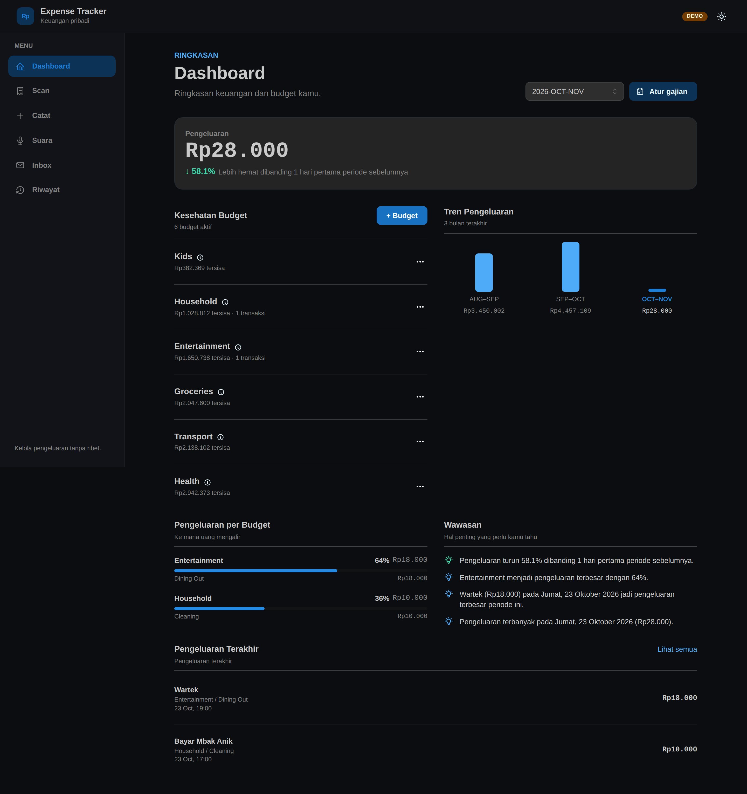
</p>

| Catat Pengeluaran | Riwayat Pengeluaran |
|---|---|
| 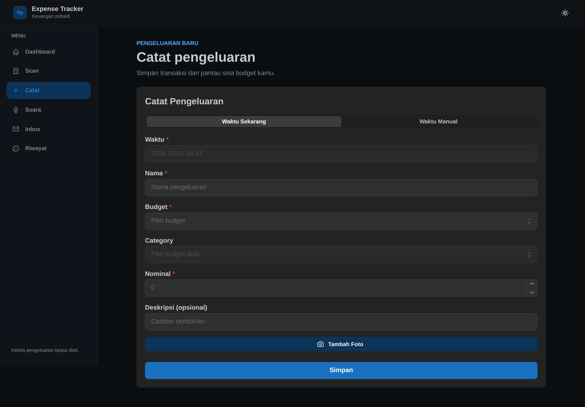 | 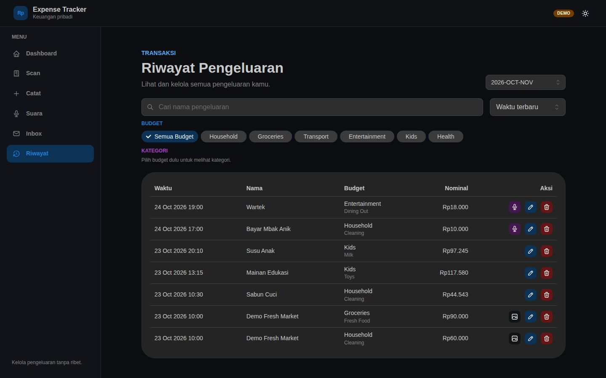 |

| Scan Struk | Inbox Email |
|---|---|
| 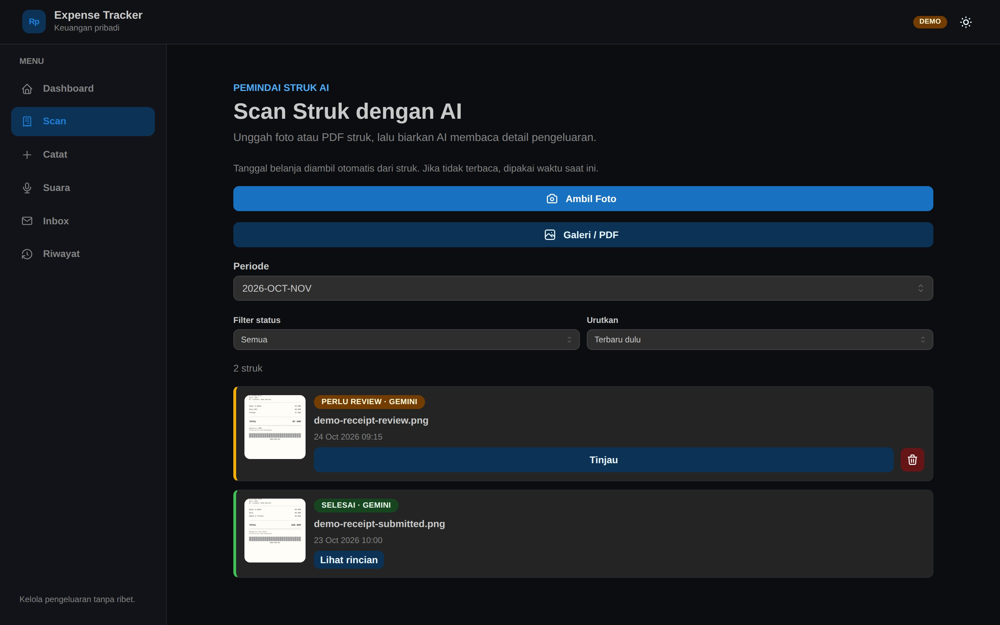 | 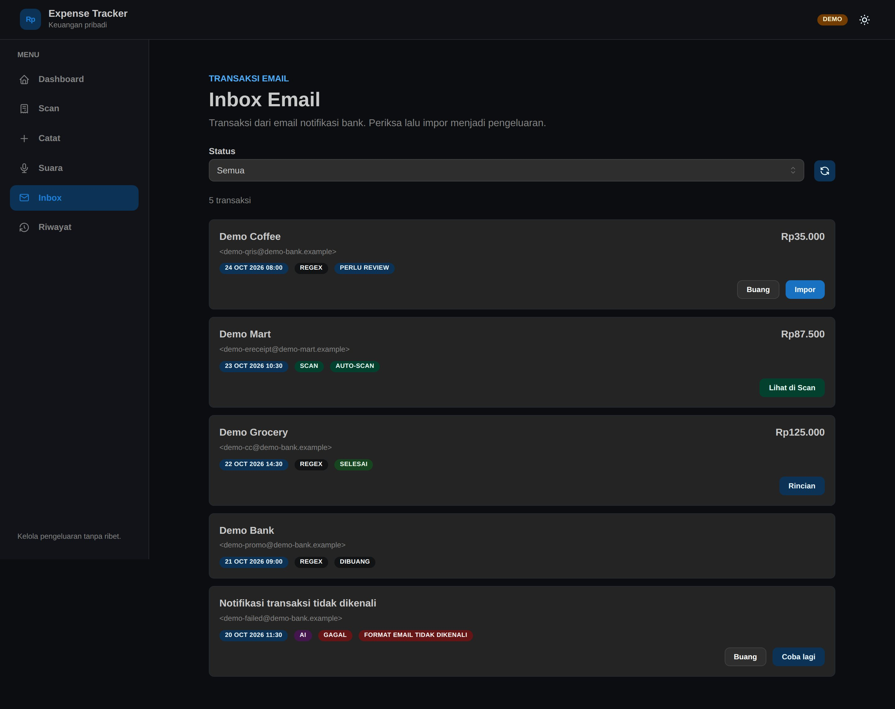 |

| Voice Assistant | Halaman PIN |
|---|---|
| 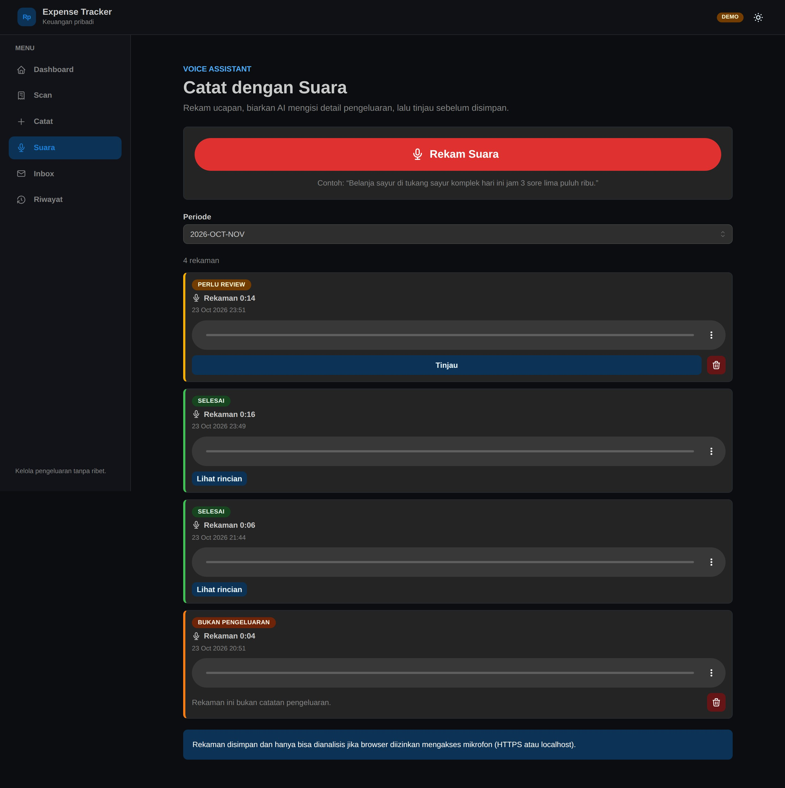 | 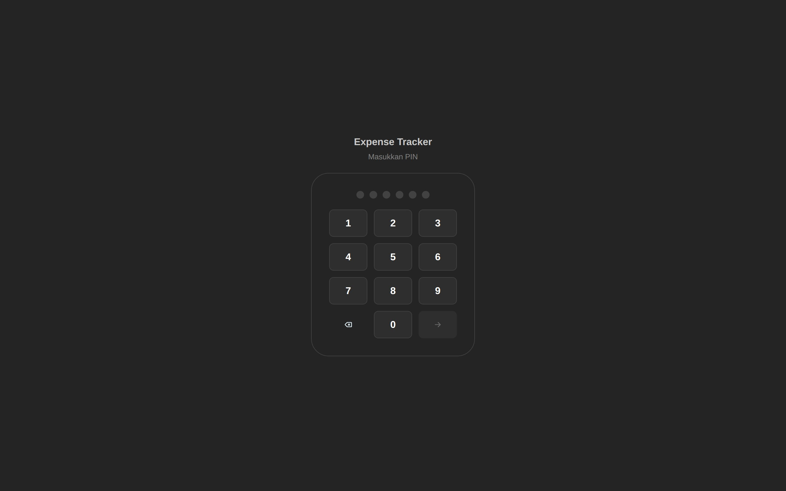 |

### Mobile

Tampilan mobile mengganti sidebar menjadi **bottom navigation**, form menjadi satu kolom, dan daftar transaksi berubah menjadi kartu agar tombol aksi tetap terlihat tanpa scroll horizontal. Screenshot Dashboard mobile juga memakai long screenshot sampai bagian paling bawah.

| Dashboard | Catat | Riwayat |
|---|---|---|
| 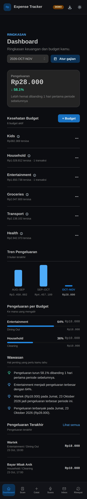 | 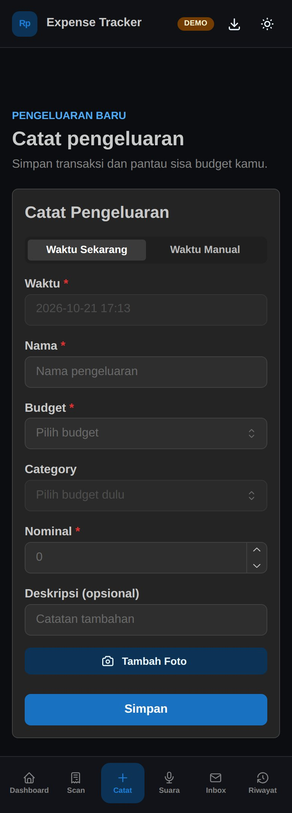 | 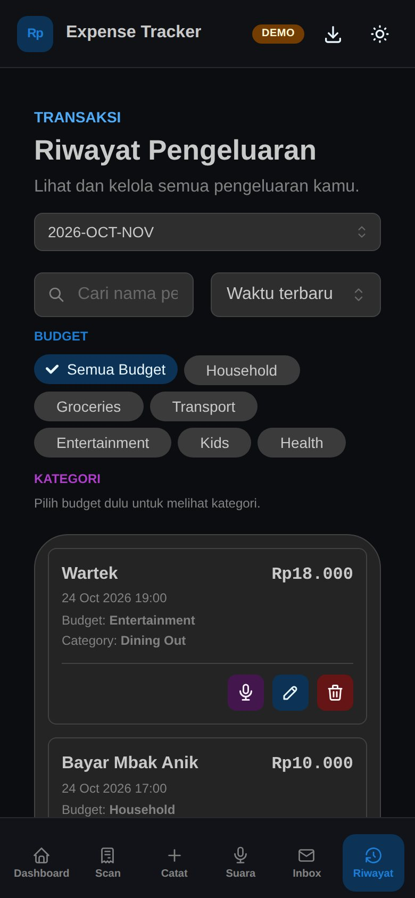 |

| Scan | Inbox | Voice |
|---|---|---|
| 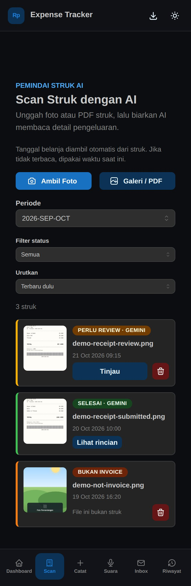 | 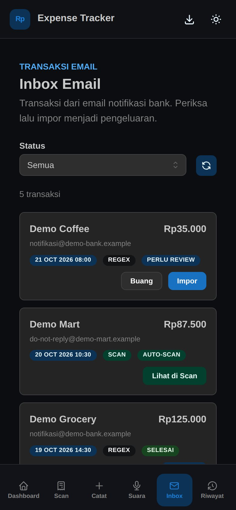 | 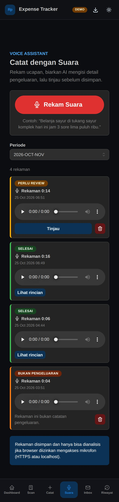 |

<p align="center">
  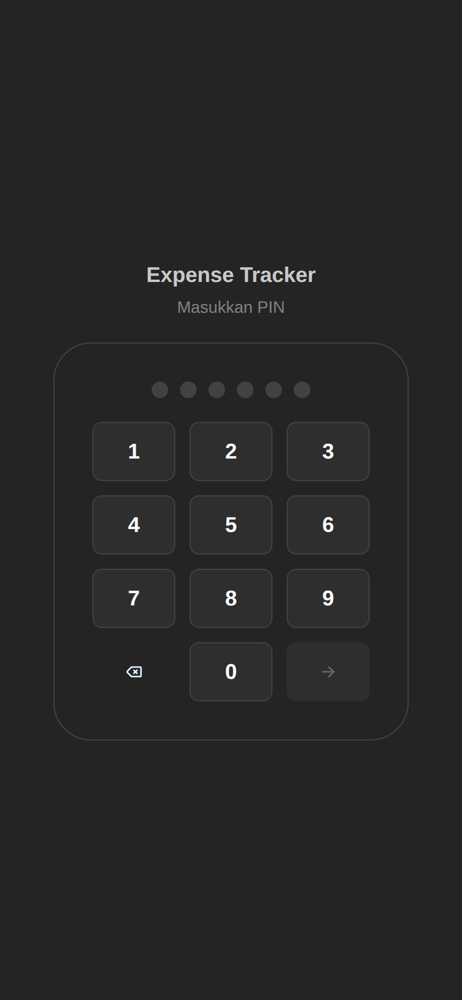
</p>

---

## Fitur

* Catat pengeluaran (waktu, nama, budget, nominal, deskripsi) + **foto invoice opsional** (kamera/galeri/pakai foto yang sudah ada di periode ini)
* **Scan Struk dengan AI** (`/scan`): upload foto/PDF → AI (Gemini) baca struk → review & assign budget → auto-create banyak expense per budget
* Saldo per budget (berkurang saat pengeluaran, bertambah via top-up)
* Dashboard: saldo per budget, pengeluaran terbesar, 3 bulan terakhir
* Riwayat per periode: search, filter, sort, **pagination**, edit (termasuk ganti/hapus foto), hapus, lihat foto (termasuk PDF)
* Kelola budget (tambah/edit/hapus, soft delete) — termasuk ambang notifikasi "budget menipis" per budget
* Idempotensi POST (header `Idempotency-Key`) untuk mencegah duplikat
* Notifikasi email (Gmail SMTP via microservice `notifier`): konfirmasi expense/top-up/budget + peringatan budget menipis (threshold per budget)
* Trace id end-to-end (header `X-Trace-Id` FE → BE → notifier) untuk menelusuri log satu request
* Dark mode (default gelap)

---

## Tech Stack

* **Frontend:** React 19 + Vite + TypeScript, React Router, TanStack Query, Axios, Mantine UI
* **Backend:** Java 25 + Spring Boot 4, Spring JDBC (JdbcTemplate), Flyway; runtime **JVM** (`Dockerfile`, default) atau GraalVM Native Image (`Dockerfile.native`, opsional/legacy)
* **AI:** Google Gemini (`gemini-3.5-flash-lite`) via JDK HttpClient untuk analisis struk (gambar/PDF)
* **Notifier:** Go (std lib `net/smtp`), kirim email via SMTP (Gmail), fallback Resend
* **Storage:** MySQL 8+

---

## Menjalankan (lokal)

```bash
docker compose up --build
```

* Frontend: http://localhost:3000
* Backend: http://localhost:8080

`docker-compose.yml` menyertakan service `mysql` sendiri (self-contained). Skema & seed budget dibuat otomatis oleh **Flyway**. Foto invoice tersimpan di direktori `./uploads` (bind mount, tetap ada meski container/project dihapus).

Untuk pengembangan cepat dengan backend **JVM** (tanpa build native), ada override `docker-compose.local.yml`:

```bash
GEMINI_API_KEY=AIza... docker compose -f docker-compose.yml -f docker-compose.local.yml up -d --build
```

---

## Menjalankan (produksi)

`docker-compose.prod.yml` memakai MySQL yang sudah ada di VPS (berbagi dengan WordPress) dan image backend **JVM** (`expense-tracker-backend-jvm:latest`). Image dibuild langsung di VPS via `./deploy-vps.sh` (terbukti aman tanpa OOM, lihat AGENTS.md).

Setup database (sekali):

```sql
CREATE DATABASE expense_tracker;
CREATE USER 'expense_tracker_user'@'%' IDENTIFIED BY 'password-kuat';
GRANT ALL PRIVILEGES ON expense_tracker.* TO 'expense_tracker_user'@'%';
FLUSH PRIVILEGES;
```

Skema dibuat otomatis oleh Flyway saat backend start (`baselineOnMigrate` menangani DB yang sudah ada).

Import budget (opsional, dari Google Sheets lama):

```bash
python3 scripts/seed_budgets.py > seed.sql
mysql -u expense_tracker_user -p expense_tracker < seed.sql
```

---

## Environment Variables

### Backend (`backend/.env`)

```text
PORT=8080
DB_URL=jdbc:mysql://host.docker.internal:33060/expense_tracker?useSSL=false&allowPublicKeyRetrieval=true&serverTimezone=UTC
DB_USER=expense_tracker_user
DB_PASSWORD=password-kuat
UPLOAD_DIR=/app/uploads
GEMINI_API_KEY=AIza...            # untuk Scan Struk dengan AI
AI_MODEL=gemini-3.5-flash-lite    # opsional, default
NOTIFIER_URL=http://notifier:8081
NOTIFY_EMAILS=email1@example.com,email2@example.com
NOTIFY_TEST_MODE=false
NOTIFY_TEST_EMAIL=your-email@gmail.com
```

### Notifier (STB Armbian, `docker-compose.stb.yml`)

Di produksi, microservice notifier dijalankan di **perangkat STB (Armbian)** yang menyala 24/7, diakses VPS lewat **WireGuard** (`10.0.0.4:8081`). Jalankan di STB:

```bash
git clone https://github.com/your-user/expense-tracker.git
export STB_BIND_IP=<ip-wireguard-stb>
cd expense-tracker
# buat .env (SMTP + Resend fallback)
docker compose -f docker-compose.stb.yml up -d --build
```

Provider diatur via `MAIL_PROVIDER` (`smtp` default, atau `resend`). Jika `RESEND_FALLBACK=true` dan SMTP gagal, otomatis coba Resend.

**SMTP (Gmail):**

```text
MAIL_PROVIDER=smtp
SMTP_HOST=smtp.gmail.com
SMTP_PORT=587
SMTP_USER=your-email@gmail.com
SMTP_APP_PASSWORD=your-gmail-app-password
NOTIFIER_TOKEN=<random-panjang>
SMTP_FROM=your-email@gmail.com
```

Gmail wajib memakai **App Password** (aktifkan 2FA dulu).

**Resend (fallback / alternatif):**

```text
MAIL_PROVIDER=resend
RESEND_API_KEY=re_xxxxxxxx
RESEND_FROM=Expense Tracker <expense_tracker@example.com>
```

Jika limit Resend tercapai (respons `429`), notifier melewatkan pengiriman (tidak dikirim, tidak retry).

Catatan: untuk pengembangan lokal, `docker-compose.yml` tetap menyertakan service `notifier` sendiri.

### Frontend

```text
VITE_API_URL=/api
```

---

## Backup & Restore MySQL

Script di VPS (membaca kredensial dari `backend/.env`).

```bash
# backup (mysqldump + gzip + simpan 14 terakhir)
cd /opt/expense-tracker
./scripts/backup_mysql.sh

# restore (menimpa DB saat ini!)
./scripts/restore_mysql.sh backups/expense_tracker_<timestamp>.sql.gz
```

Cron harian sudah terpasang di VPS (03:00 WIB), log di `/var/log/expense-backup.log`.

---

## API

Dokumentasi lengkap ada di `PRD.md`. Ringkasan endpoint (`/api`):

* `GET /health`, `/options`, `/periods`
* `GET/POST /expenses`, `PUT/DELETE /expenses/{id}`, `POST /expenses/batch`
* `POST/GET/DELETE /expenses/{id}/photo`
* `GET /invoices?date=&scan=`, `POST /invoices`, `GET /invoices/{id}`, `POST /invoices/{id}/retry`, `GET /invoices/{id}/photo`
* `GET /summary?period=`, `/trend?months=`
* `GET/POST /topups`
* `POST /budgets`, `PUT/DELETE /budgets/{name}`

Semua endpoint `POST` menerima header `Idempotency-Key` opsional (uuid) untuk mencegah duplikat.

---

## Build & Deploy (produksi)

Build & deploy hanya dari PC lokal (butuh RAM ~7GB untuk build native).

```bash
./build-native.sh       # build image native lokal (~6 menit)
./deploy-native.sh      # deploy penuh: export native image -> scp -> VPS git pull -> up -d -> prune
VPS_HOST=<host-vps> VPS_DIR=/opt/expense-tracker ./deploy-vps.sh  # deploy penuh produksi
STB_HOST=<ip-wireguard-stb> STB_DIR=/opt/expense-tracker ./deploy-stb.sh  # deploy notifier ke STB
```

* Regenerasi native config saat menambah endpoint/model: `./backend/generate-native-config.sh`
* Cleanup data (expense/invoice/topup/idempotency + folder upload, **tabel budget dipertahankan**): `scripts/clean_data.sh`
* `deploy-native.sh` / `deploy-vps.sh` mengasumsikan SSH key `root@example.com` terdaftar; `deploy-stb.sh` mengasumsikan SSH key `root@10.0.0.4` (WireGuard) terdaftar.

---

## Project Structure

```
frontend/   # React (Vite)
backend/    # Spring Boot
  src/main/resources/db/migration/   # Flyway migration
notifier/   # Go microservice notifikasi email (SMTP, fallback Resend)
scripts/    # backup, restore, seed, clean_data
docker-compose.yml       # lokal (dengan mysql + notifier service, backend JVM default)
docker-compose.local.yml # override dev: backend JVM (build dari backend/Dockerfile)
docker-compose.prod.yml  # produksi (MySQL VPS, backend JVM)
docker-compose.stb.yml   # notifier di STB Armbian (WireGuard 10.0.0.4)
uploads/                 # foto/PDF invoice (bind mount)
```
