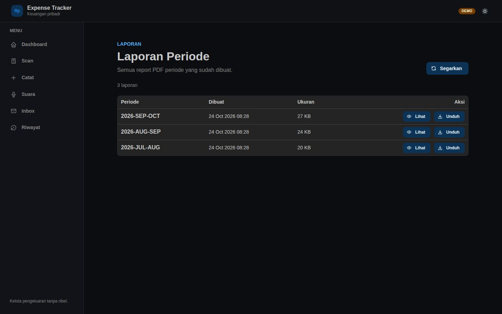
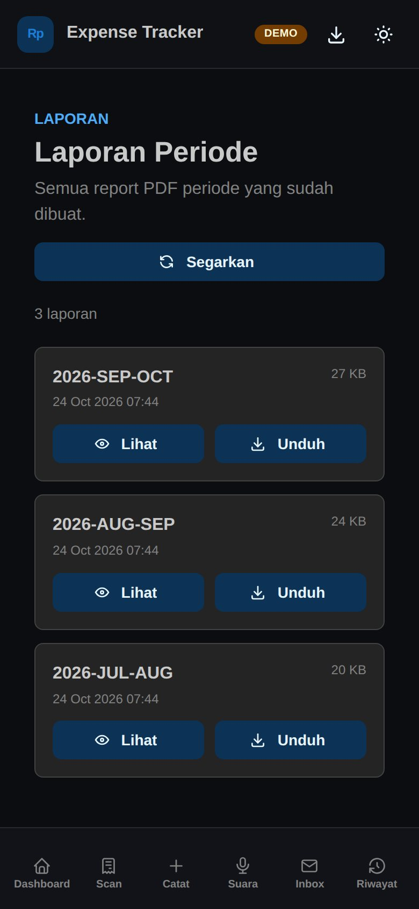

# Expense Tracker

Aplikasi web untuk mencatat pengeluaran harian, memantau saldo per budget, dan mengelola riwayat. Backend memakai **MySQL**.

**Versi:** `v1.0.0`

---

## Live Demo

**https://frmnjn.my.id/expense-tracker-demo/**

Demo bersifat **read-only** (tidak bisa menambah/mengubah data), memakai data dummy, dan tidak terhubung ke AI, email, atau notifier production. Badge **DEMO** di kanan atas menandakan mode read-only. Demo berjalan **tanpa backend/MySQL**: frontend mengambil data dari `frontend/public/demo/data.json` dan report PDF statis. Data dan PDF digenerate harian (tanggal mengikuti hari generate) dengan:

```bash
./scripts/generate_demo.sh        # generate data.json + report PDF
./scripts/install_demo_cron.sh    # pasang cron harian 00:05 WIB
docker compose -f docker-compose.demo.yml up -d --build
```

Demo berisi contoh invoice (`TO_REVIEW`/`SUBMITTED`/`NOT_INVOICE`), email inbox, voice note (`TO_REVIEW`/`SUBMITTED`/`NOT_EXPENSE`), dan tiga report PDF periode sebelumnya.

## Screenshots

### Desktop

Tampilan desktop memakai sidebar di kiri, konten lebar, dan tabel untuk daftar transaksi. Screenshot Dashboard desktop dan mobile memakai **long screenshot** agar seluruh kartu budget, grafik tren, dan ringkasan bawah tidak terpotong.

```bash
./scripts/capture-screenshots.sh
```


<p align="center">
  
</p>

| Catat Pengeluaran | Riwayat Pengeluaran |
|---|---|
|  |  |

| Scan Struk | Inbox Email |
|---|---|
|  |  |

| Voice Assistant | Laporan |
|---|---|
|  |  |

### Mobile

Tampilan mobile mengganti sidebar menjadi **bottom navigation**, form menjadi satu kolom, dan daftar transaksi berubah menjadi kartu agar tombol aksi tetap terlihat tanpa scroll horizontal. Filter budget & kategori ditampilkan sebagai chip yang **wrap ke bawah** (bukan scroll horizontal), dengan section **BUDGET** dan **KATEGORI** yang terpisah. Screenshot Dashboard mobile juga memakai long screenshot sampai bagian paling bawah.

| Dashboard | Catat | Riwayat |
|---|---|---|
|  |  |  |

| Scan | Inbox | Voice |
|---|---|---|
|  |  |  |

| Laporan |
|---|
|  |

---

## Fitur

* Catat pengeluaran (waktu, nama, budget, nominal, deskripsi) + **foto invoice opsional** (kamera/galeri/pakai foto yang sudah ada di periode ini)
* **Scan Struk dengan AI** (`/scan`): upload foto/PDF → AI (Gemini) baca struk → review & assign budget → auto-create banyak expense per budget
* Saldo per budget (berkurang saat pengeluaran, bertambah via top-up)
* Dashboard: saldo per budget, pengeluaran terbesar, 3 bulan terakhir
* Riwayat per periode: search, **filter budget & kategori multi-select**, sort, **pagination**, edit (termasuk ganti/hapus foto), hapus, lihat foto (termasuk PDF)
* Kelola budget (tambah/edit/hapus, soft delete) — termasuk ambang notifikasi "budget menipis" per budget
* Idempotensi POST atomik (header `Idempotency-Key`) untuk mencegah duplikat
* Shared access code (PIN) untuk membuka aplikasi; API fail-closed bila `ACCESS_CODE` kosong
* Notifikasi email (Gmail SMTP via microservice `notifier`): konfirmasi expense/top-up/budget + peringatan budget menipis (threshold per budget)
* **Report PDF otomatis per periode**: saat periode baru dimulai, laporan lengkap periode sebelumnya (ringkasan, rincian budget/kategori, analisis, seluruh transaksi) dibuat via HTML/CSS → PDF dalam Bahasa Indonesia (email report tetap Bahasa Inggris), disimpan di `uploads/reports/`, dikirim sebagai lampiran email, dan bisa dilihat/diunduh lewat halaman **Laporan** (tombol di Dashboard)
* Trace id end-to-end (header `X-Trace-Id` FE → BE → notifier) untuk menelusuri log satu request
* Dark mode (default gelap)

---

## Tech Stack

* **Frontend:** React 19 + Vite + TypeScript, React Router, TanStack Query, Axios, Mantine UI
* **Backend:** Java 25 + Spring Boot 4, Spring JDBC (JdbcTemplate), Flyway; runtime **JVM** (`Dockerfile`, default produksi). GraalVM Native (`Dockerfile.native`) opsional/legacy.
* **AI:** Google Gemini (`gemini-3.5-flash-lite`) via JDK HttpClient untuk analisis struk (gambar/PDF)
* **Report PDF:** HTML/CSS → PDF via Flying Saucer + OpenPDF; PDFBox untuk render invoice PDF & stempel nomor halaman
* **Notifier:** Go (std lib `net/smtp`), kirim email via SMTP (Gmail), fallback Resend, mendukung lampiran PDF
* **Storage:** MySQL 8+

---

## Menjalankan (lokal)

```bash
docker compose up --build
```

* Frontend: http://localhost:3000
* Backend: http://localhost:8080

`docker-compose.yml` menyertakan service `mysql` sendiri (self-contained) dan sekarang juga men-*build* backend. Skema dibuat otomatis oleh **Flyway**. Foto invoice tersimpan di direktori `./uploads` (bind mount, tetap ada meski container/project dihapus).

Default access code untuk lokal adalah `123456` (ubah lewat `ACCESS_CODE`). Health check: `http://localhost:8080/health`.

Untuk memakai konfigurasi tambahan (AI, email), buat `backend/.env` dari contoh:

```bash
cp backend/.env.example backend/.env   # opsional
GEMINI_API_KEY=AIza... docker compose up -d --build
```

---

## Menjalankan (produksi)

Produksi memakai dua host:

* **VPS** — nginx/reverse proxy, frontend, backend JVM, dan MySQL. Image backend dibuild langsung di VPS via `./deploy-vps.sh` (backup DB dulu, tag commit + `latest`, health gate `/ready`).
* **STB Armbian** — microservice notifier email yang menyala 24/7. VPS menjangkaunya lewat WireGuard. Notifier dipisah karena SMTP keluar dari VPS diblokir.

```text
Internet
   |
   v
nginx (VPS) -> frontend + backend (VPS) -> MySQL (VPS)
                              |
                              | WireGuard
                              v
                      notifier (STB Armbian) -> SMTP / Resend
```

Konfigurasi domain, IP, dan kredensial sengaja tidak disimpan di repo ini. Isi lewat environment variable saat deploy, misalnya `PUBLIC_BASE_URL=https://<domain-produksi-anda>`.

Setup database (sekali):

```sql
CREATE DATABASE expense_tracker;
CREATE USER 'expense_tracker_user'@'%' IDENTIFIED BY 'password-kuat';
GRANT ALL PRIVILEGES ON expense_tracker.* TO 'expense_tracker_user'@'%';
FLUSH PRIVILEGES;
```

Skema dibuat otomatis oleh Flyway saat backend start (`baselineOnMigrate` menangani DB yang sudah ada).

Import budget (opsional, dari Google Sheets lama):

```bash
python3 scripts/seed_budgets.py > seed.sql
mysql -u expense_tracker_user -p expense_tracker < seed.sql
```

---

## Environment Dev (VPS)

Dev berjalan di subdomain terpisah dari produksi (domain dikonfigurasi di nginx dan tidak disimpan di repo):

* MySQL produksi dipakai bersama, tetapi memakai schema `expense_tracker_dev` dan user khusus dengan grant hanya ke schema tersebut.
* Notifier produksi dipakai ulang.
* Email dipaksa `NOTIFY_TEST_MODE=true` ke alamat email developer yang diisi di `backend/.env.dev`; inbox polling dan report otomatis dimatikan.
* Upload dan report disimpan di `uploads-dev/`.

Setup sekali:

```bash
cp backend/.env.dev.example backend/.env.dev
chmod 600 backend/.env.dev
# isi DB_PASSWORD, ACCESS_CODE, NOTIFIER_TOKEN, dan API key
```

Buat schema + user (dari VPS, lewat container MySQL):

```bash
docker exec -i wordpress-db-1 sh -c 'mysql -uroot -p"$MYSQL_ROOT_PASSWORD"' <<'SQL'
CREATE DATABASE IF NOT EXISTS expense_tracker_dev;
CREATE USER IF NOT EXISTS 'expense-tracker-dev'@'%' IDENTIFIED BY '<password-dev>';
GRANT ALL PRIVILEGES ON expense_tracker_dev.* TO 'expense-tracker-dev'@'%';
FLUSH PRIVILEGES;
SQL
```

Jalankan / update:

```bash
./scripts/deploy-dev.sh
```

Seed data dummy (opsional):

```bash
python3 scripts/seed_dummy_data.py \
  --container wordpress-db-1 \
  --db-user expense-tracker-dev \
  --db-password '<password-dev>' \
  --db expense_tracker_dev
```

Hentikan / hapus:

```bash
docker compose -p expense-dev -f docker-compose.dev.yml down        # simpan data
docker compose -p expense-dev -f docker-compose.dev.yml down -v     # hapus data DB
rm -rf uploads-dev
```

---

## Environment Variables

### Backend (`backend/.env`)

```text
PORT=8080
DB_URL=jdbc:mysql://<mysql-host>:<mysql-port>/expense_tracker?useSSL=false&allowPublicKeyRetrieval=true&serverTimezone=UTC
DB_USER=expense_tracker_user
DB_PASSWORD=password-kuat
UPLOAD_DIR=/app/uploads
ACCESS_CODE=123456                 # wajib di produksi; API fail-closed bila kosong
ACCESS_ALLOW_BLANK=false           # true hanya untuk dev (mematikan auth)
GEMINI_API_KEY=AIza...            # untuk Scan Struk dengan AI
AI_MODEL=gemini-3.5-flash-lite    # opsional, default
AI_TIMEOUT=60                     # opsional, detik
AI_MAX_ATTEMPTS=5                 # opsional, retry Gemini
NOTIFIER_URL=http://notifier:8081
NOTIFY_EMAILS=email1@example.com,email2@example.com
NOTIFY_TEST_MODE=false
NOTIFY_TEST_EMAIL=your-email@gmail.com
REPORT_ENABLED=true               # opsional, default true
REPORT_CRON=0 5 0 * * *           # opsional, default cek tiap 00:05
REPORT_GRACE_DAYS=1               # opsional, toleransi hari setelah periode baru mulai
REPORT_ZONE=Asia/Jakarta          # opsional, zona waktu report
TZ=Asia/Jakarta                   # zona waktu container
```

### Notifier (STB Armbian, `docker-compose.stb.yml`)

Di produksi, microservice notifier dijalankan di **perangkat STB (Armbian)** yang menyala 24/7, diakses VPS lewat **WireGuard** (`<stb-wireguard-ip>:8081`). Jalankan di STB:

```bash
git clone <repo-url>
export STB_BIND_IP=<ip-wireguard-stb>
cd expense-tracker
# buat .env (SMTP + Resend fallback)
docker compose -f docker-compose.stb.yml up -d --build
```

Provider diatur via `MAIL_PROVIDER` (`smtp` default, atau `resend`). Jika `RESEND_FALLBACK=true` dan SMTP gagal, otomatis coba Resend.

**SMTP (Gmail):**

```text
MAIL_PROVIDER=smtp
SMTP_HOST=smtp.gmail.com
SMTP_PORT=587
SMTP_USER=your-email@gmail.com
SMTP_APP_PASSWORD=your-gmail-app-password
NOTIFIER_TOKEN=<random-panjang>
SMTP_FROM=your-email@gmail.com
```

Gmail wajib memakai **App Password** (aktifkan 2FA dulu).

**Resend (fallback / alternatif):**

```text
MAIL_PROVIDER=resend
RESEND_API_KEY=re_xxxxxxxx
RESEND_FROM=Expense Tracker <expense_tracker@example.com>
```

Jika limit Resend tercapai (respons `429`), notifier melewatkan pengiriman (tidak dikirim, tidak retry).

Catatan: untuk pengembangan lokal, `docker-compose.yml` tetap menyertakan service `notifier` sendiri.

### Frontend

```text
VITE_API_URL=/api
```

---

## Backup & Restore MySQL

Script di VPS (membaca kredensial dari `backend/.env`).

```bash
# backup (mysqldump + gzip + simpan 14 terakhir, permission 0600)
cd /root/expense-tracker
./scripts/backup_mysql.sh

# restore (menimpa DB saat ini; otomatis backup dulu + minta konfirmasi)
./scripts/restore_mysql.sh backups/expense_tracker_<timestamp>.sql.gz
# tanpa konfirmasi (hati-hati)
./scripts/restore_mysql.sh -f backups/expense_tracker_<timestamp>.sql.gz
```

Cron harian sudah terpasang di VPS (03:00 WIB), log di `/var/log/expense-backup.log`.

---

## API

Dokumentasi lengkap ada di `PRD.md`. Ringkasan endpoint (`/api`):

* `GET /health` & `/ready` (cek koneksi DB), `/options`, `/periods`
* `GET/POST /expenses`, `GET/PUT/DELETE /expenses/{id}`, `POST /expenses/batch`
* `POST/GET/DELETE /expenses/{id}/photo`
* `GET /invoices?date=&scan=&period=`, `POST /invoices`, `GET /invoices/{id}`, `POST /invoices/{id}/retry`, `DELETE /invoices/{id}`, `GET /invoices/{id}/photo`
* `GET /summary?period=`, `/trend?months=`
* `GET/POST /topups`
* `POST /budgets`, `PUT/DELETE /budgets/{name}`, `GET/POST /categories`, `PUT/DELETE /categories/{id}`
* `GET/POST /voice-notes`, `GET/DELETE /voice-notes/{id}`, `POST /voice-notes/{id}/retry`, `GET /voice-notes/{id}/audio`
* `GET/PATCH/DELETE /email-imports...`, `POST /email-imports/poll`, `GET /email-imports/poll/status`
* `GET/POST/DELETE /reports...`
* `GET/POST/DELETE /payday-overrides...`

Endpoint yang mengubah data menerima header `Idempotency-Key` opsional (uuid) untuk mencegah duplikat; key di-scope per endpoint.

Status HTTP: create `201`, sukses `200`, validasi `400`, tidak ditemukan `404`, konflik `409`, poll email `202`.

---

## Build & Deploy (produksi)

Jalur produksi adalah **JVM** dan dibuild langsung di VPS:

```bash
PUBLIC_BASE_URL=https://<domain-produksi-anda> \
VPS_HOST=<host-vps> VPS_DIR=/root/expense-tracker ./deploy-vps.sh  # backup -> build -> up -> health gate
STB_HOST=<stb-wireguard-ip> STB_DIR=/root/expense-tracker ./deploy-stb.sh  # deploy notifier ke STB
```

`deploy-vps.sh` melakukan backup DB sebelum migrasi, membuat tag image per commit + `rollback-<timestamp>`, lalu memverifikasi `/ready`. Native build (`build-native.sh`, `deploy-native.sh`) hanya opsional/legacy.

* Cleanup data (expense/invoice/voice/email/topup/report/idempotency + folder upload, **budget dipertahankan**): `scripts/clean_data.sh`
* CI (`.github/workflows/ci.yml`) menjalankan test backend, lint/build frontend, build notifier, dan validasi compose.
* Checklist rilis & rollback: `docs/release.md`.
* `deploy-vps.sh` mengasumsikan SSH key `root@$VPS_HOST` terdaftar; `deploy-stb.sh` mengasumsikan SSH key `root@$STB_HOST` (WireGuard) terdaftar.

---

## Project Structure

```
frontend/   # React (Vite)
backend/    # Spring Boot
  src/main/resources/db/migration/   # Flyway migration
notifier/   # Go microservice notifikasi email (SMTP, fallback Resend)
scripts/    # backup, restore, seed, clean_data
docker-compose.yml       # lokal (dengan mysql + notifier service, backend JVM default)
docker-compose.local.yml # override dev: backend JVM (build dari backend/Dockerfile)
docker-compose.prod.yml  # produksi (MySQL VPS, backend JVM)
docker-compose.stb.yml   # notifier di STB Armbian via WireGuard
.github/workflows/       # CI (test/build) + CodeQL
docs/                    # referensi tambahan
uploads/                 # foto/PDF invoice (bind mount)
```
